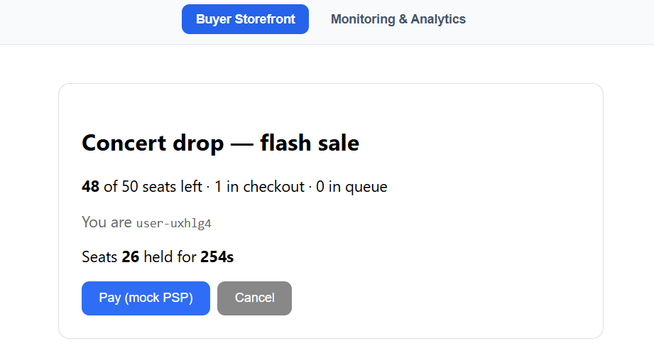
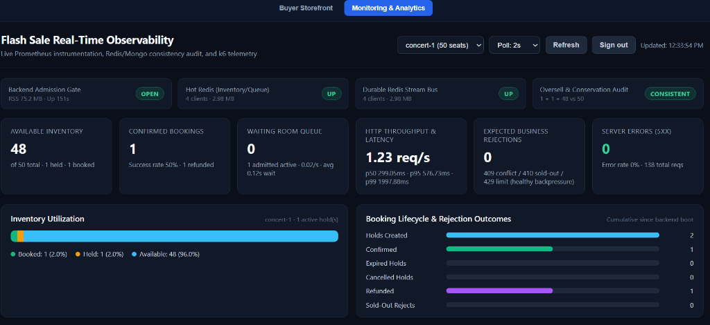

# Flash-Sale Booking Engine with Virtual Waiting Room

A high-concurrency flash-sale ticketing and seat-booking engine built with **Node.js / Express**, **React + Vite**, **Redis 7** (atomic Lua scripts + Redis Streams), and **MongoDB 7** (replica-set transactions + unique seat constraints). Designed to survive burst traffic, duplicate payment webhook storms, and mid-sale Redis failovers with **zero oversell**.

---

## Live Deployment

* **Live App (Vercel):** https://himanshi-flashsale-uiwerx.vercel.app
* **Monitoring & Analytics UI:** https://himanshi-flashsale-uiwerx.vercel.app/#/monitor *(requires `ADMIN_TOKEN`)*
* **Backend Health & Metrics (Render):** https://flashsale-engine-4lel.onrender.com/healthz · https://flashsale-engine-4lel.onrender.com/metrics

### Screenshots

#### Buyer Storefront (Waiting Room & Seat Hold Checkout)


#### Real-Time Observability & Analytics Dashboard


---

## Architecture Overview

```text
React (Vite :5173) ──REST / SSE──► Express (:8080)
                                      ├─► Waiting Room   (FIFO ZSET + token bucket + HMAC-SHA256 tokens)
                                      ├─► Hold Path      (Redis Lua: atomic check + SPOP seats + PX TTL)
                                      ├─► Payment Hook   (HMAC-verified, idempotent claim -> Lua confirm -> Mongo txn)
                                      └─► Expiry         (Keyspace notifications + Redis ZSET sweeper + Mongo sweeper)

MongoDB Outbox ──relay (leader lock)──► Redis Stream (AOF) ──► Consumer Group (dedupe + analytics/notifications)
Reconciler     ──detects Redis run_id change──► Closes admission gate ─► Rebuilds Redis from MongoDB ─► Reopens gate
```

### Core Consistency Model
* **Redis is the fast path** (hot inventory sets, holds, waiting room queues) and is configured intentionally **without persistence** in `docker-compose.yml` to simulate failover/state loss.
* **MongoDB is the durable source of truth**, enforcing a unique compound index `{ itemId: 1, seatId: 1 }` on `bookings` as the final guarantee against double-booking.
* **Event bus (`redis-bus`)** runs Redis Streams with AOF persistence for at-least-once delivery; consumers deduplicate using a 24-hour `seen:<id>` key.

---

## Key Guarantees & Invariants

Verified at any time via `GET /admin/verify/:id`:
* **Zero oversell (`noOversell`):** `booked <= totalSeats`, `duplicateSeats === 0`, and `outOfRange === 0`.
* **Seat conservation (`conserved`):** When quiescent (holds settled), `booked + redisFree + heldSeats === totalSeats`.
* **Idempotent payments:** Concurrent identical webhook deliveries (`repeat > 1`) share a single-flight `idempotency_keys` claim with stale-lease recovery and produce exactly one side effect.
* **Late-payment handling:** If a hold expires before payment arrives, `flashConfirm` attempts an all-or-nothing re-claim of the same seats; if unavailable, the system records a `PaymentRefunded` outbox event (`LATE_PAYMENT_SEATS_UNAVAILABLE`).

---

## Tech Stack

| Layer | Technology |
| :--- | :--- |
| **Frontend** | React 18, Vite 5 (proxying `/api` and `/dev` to backend) |
| **Backend API** | Node.js >= 20, Express 4 |
| **Hot Inventory & Queue** | Redis 7 (`ioredis`, 5 atomic Lua scripts) |
| **Durable Storage** | MongoDB 7 (single-node replica set `rs0` for multi-doc transactions) |
| **Event Bus** | Redis 7 Streams (`appendonly yes`) |
| **Observability** | Prometheus, Grafana (3 provisioned dashboards), `redis_exporter`, React Admin Monitor |
| **Load & Chaos Testing** | Grafana k6 (with Prometheus Remote Write), Bash chaos/verification scripts |
| **Optional Ops Copilot** | LangGraph.js + local Ollama (`llama3.2`) with deterministic fallback |

---

## Project Structure

```text
.
├── backend/
│   ├── Dockerfile              # Node 20 Alpine production container
│   ├── package.json            # Backend dependencies (express, ioredis, mongodb)
│   ├── scripts/
│   │   └── test-lua.js         # Redis Lua unit + 5,000-concurrent contention test
│   └── src/
│       ├── config.js           # Environment configuration and defaults
│       ├── db.js               # MongoDB connection, indexes, and transaction helper
│       ├── gate.js             # In-process admission gate flag
│       ├── redis.js            # Redis/bus clients + atomic Lua scripts
│       ├── admission.js        # Token bucket, HMAC queue tokens, leader-elected admission loop
│       ├── booking.js          # Seat holds, release, idempotent payment confirmation & refunds
│       ├── expiry.js           # 3-tier hold expiration (keyspace events, Redis ZSET, Mongo sweeper)
│       ├── metrics.js          # Prometheus registry, 5s inventory/Redis sampler, rolling summary
│       ├── reconcile.js        # Redis run_id failover detector and state rebuilder
│       ├── relay.js            # Transactional outbox relay and deduplicating stream consumer
│       └── server.js           # Express REST/SSE API, /metrics, mock PSP (/dev/pay), and admin routes
├── frontend/
│   ├── index.html
│   ├── vite.config.js          # Dev server (:5173) + proxy (/api, /dev, /admin -> :8080)
│   └── src/
│       ├── main.jsx
│       ├── MonitoringDashboard.jsx  # Authenticated dark-theme observability & analytics UI
│       ├── MonitoringDashboard.css
│       └── App.jsx             # Storefront + Monitoring view switcher
├── monitoring/
│   ├── prometheus/
│   │   └── prometheus.yml      # Scrape config for backend:8080 & redis-exporter:9121
│   └── grafana/
│       ├── provisioning/       # Auto-provisioned Prometheus datasource & dashboard provider
│       └── dashboards/         # system-overview.json, flashsale-analytics.json, load-testing.json
├── loadtest/
│   └── k6.js                   # Ramping-VU burst test with 3x retry storms & 4xx/5xx separation
├── ops-agent/
│   ├── package.json
│   └── agent.js                # Optional LangGraph.js + Ollama post-run health summarizer
├── scripts/
│   ├── chaos.sh                # Kills Redis twice and restarts backend mid-load, then verifies
│   └── verify.sh               # Checks /admin/verify/:id invariants
├── docker-compose.yml          # Full stack + Prometheus + Grafana + redis-exporter + k6
└── Makefile                    # Convenience targets for up, seed, load, chaos, verify, test-lua, test-metrics
```

---

## Prerequisites

* **Docker & Docker Compose** (v2+)
* **Node.js >= 20** & **npm** (if running `test-lua` or `ops-agent` locally)
* **GNU Make** & `curl` / `bash` (optional, for `Makefile` and `scripts/*.sh`)

---

## Quick Start

1. **Start the full stack:**
   ```bash
   make up
   # Equivalent: docker compose up --build -d mongo redis redis-bus backend frontend
   ```

2. **Seed a flash-sale item (`concert-1`, 50 seats):**
   ```bash
   make seed
   ```

3. **Open the UI:**
   Visit `http://localhost:5173`, join the waiting room, hold up to 4 seats, and test checkout via the mock PSP.

4. **Stop and clean volumes:**
   ```bash
   make down
   ```

---

## Configuration (Environment Variables)

| Variable | Default (`config.js` / Compose) | Description |
| :--- | :--- | :--- |
| `PORT` | `8080` | Backend HTTP port |
| `MONGO_URL` | `mongodb://localhost:27017/?replicaSet=rs0` (`mongodb://mongo:27017/?replicaSet=rs0` in Compose) | MongoDB replica set URI |
| `DB_NAME` | `flashsale` | MongoDB database name |
| `REDIS_URL` | `redis://localhost:6379` (`redis://redis:6379` in Compose) | Ephemeral hot-path Redis URI |
| `BUS_URL` | `redis://localhost:6380` (`redis://redis-bus:6379` in Compose) | Durable AOF Redis Streams URI |
| `TOKEN_SECRET` | `dev-token-secret` (`change-me` in Compose) | HMAC secret for waiting-room admission tokens |
| `WEBHOOK_SECRET` | `dev-webhook-secret` (`change-me-too` in Compose) | HMAC secret for `/webhooks/payment` signatures |
| `ADMIN_TOKEN` | `admin-secret` | Header token (`x-admin-token`) for `/admin/*` endpoints |
| `SELF_URL` | `http://127.0.0.1:${PORT}` | Base URL used by `/dev/pay` to post signed webhooks |
| `HOLD_TTL_SEC` | `300` | Seat hold expiration TTL in seconds |
| `ADMIT_RATE` | `200` | Users admitted per second per item |
| `ADMIT_BURST` | `400` | Token bucket burst capacity |
| `MAX_ACTIVE` | `2000` | Maximum concurrently admitted users per item |
| `ADMIT_TTL_SEC` | `180` | Admission token validity in seconds |
| `JOIN_RPS` | `5000` | Per-instance rate limit on `/api/queue/join` |
| `MOCK_PSP` | `true` | Enables `/dev/pay` mock payment endpoint (set `false` in production) |
| `RUN_CONSUMER` | `true` | Runs the in-process Redis Stream `notifier` consumer |
| `PROMETHEUS_URL` | `http://prometheus:9090` (Compose) | Optional Prometheus URL queried by `/admin/metrics/summary` for live k6 stats |
| `GRAFANA_ADMIN_USER` / `GRAFANA_ADMIN_PASSWORD` | `admin` / `admin` | Grafana login credentials in Compose |

---

## API & Webhook Reference

### Public & Waiting Room
* `GET /healthz` — Returns `{ ok: true, admissionOpen }`.
* `GET /api/items/:id` — Returns item details, available seats, active holds, queue length, and gate state.
* `POST /api/queue/join` — Enters the FIFO queue (`{ itemId, userId }`).
* `GET /api/queue/status?itemId=...&userId=...` — Polls waiting-room position, ETA, or signed admission token.
* `GET /api/queue/events?itemId=...&userId=...` — Server-Sent Events (SSE) stream pushing live queue/admission updates.

### Booking (Requires `Authorization: Bearer <queue-token>`)
* `POST /api/holds` — Atomically holds `1..4` seats (`{ qty }`).
* `GET /api/holds/:id` — Inspects hold status and assigned seats for the token owner.
* `DELETE /api/holds/:id` — Cancels an active hold and returns seats to the free pool.

### Payments & Mock PSP
* `POST /webhooks/payment` — Verified via `x-signature` (hex HMAC-SHA256 of raw JSON body using `WEBHOOK_SECRET`). Idempotent per `eventId`.
* `POST /dev/pay` *(when `MOCK_PSP=true`)* — Triggers signed payment webhooks against `/webhooks/payment` (`repeat` up to `50` simulates concurrent retry storms).

### Admin & Observability
* `GET /metrics` — Prometheus exposition endpoint (HTTP, booking, inventory, Redis, waiting room, and Node.js process metrics).
* `POST /admin/items?reset=true` *(Requires `x-admin-token`)* — Creates/updates an item and rebuilds its Redis inventory (with optional reset of bookings/holds/outbox/queue).
* `GET /admin/verify/:id` *(Requires `x-admin-token`)* — Audits oversell, duplicate seats, seat conservation, hold status counts, and recent stream analytics/notifications.
* `GET /admin/metrics/summary?itemId=...` *(Requires `x-admin-token`)* — Real-time JSON snapshot, rolling 60s history, inventory audit, and optional k6 Prometheus telemetry for the React Monitoring Dashboard.

---

## Monitoring & Dashboards

1. **Start the stack (including Prometheus, `redis-exporter`, and Grafana):**
   ```bash
   make up
   make seed
   ```
2. **Access URLs:**
   * **React Storefront & Monitoring UI:** `http://localhost:5173` (click **Monitoring & Analytics** or visit `http://localhost:5173/#/monitor` and enter your `ADMIN_TOKEN`).
   * **Grafana:** `http://localhost:3000` (default `admin` / `admin`; dashboards are auto-provisioned in folder **FlashSale**):
     * *Dashboard A: System Overview* (`flashsale-system-overview`)
     * *Dashboard B: Flash Sale Analytics* (`flashsale-analytics`)
     * *Dashboard C: Load Testing (k6 + Invariants)* (`flashsale-load-testing`)
   * **Prometheus:** `http://localhost:9090`
   * **Backend Prometheus Metrics:** `http://localhost:8080/metrics`

### Metric Semantics & Limitations
* **HTTP Latency Exclusion:** Long-lived SSE streams (`/api/queue/events`) are excluded from `flashsale_http_request_duration_seconds` and tracked separately via `flashsale_sse_active_connections` so open tabs do not distort p95/p99 API latency.
* **4xx Business Rejections vs. 5xx Errors:** Expected flash-sale backpressure (`409` duplicate hold/conflict, `410` sold out, `429` queue rate limit) is classified under `status_class="4xx_business"` (and ignored by k6 `http_req_failed`) so genuine `5xx` server errors stand out immediately.
* **Inventory Sampling & Quiescent Conservation:** Inventory and consistency gauges are sampled every 5s (not per-scrape) to avoid putting extra query load on MongoDB and Redis. `flashsale_inventory_oversell_violations` must **always** remain `0`; `flashsale_inventory_consistency_violations` checks `booked + available + held == total` and may briefly report `1` while a multi-step checkout transaction or Redis rebuild is mid-flight, returning to `0` once quiescent.
* **Label Cardinality:** Labels are restricted to bounded values (`method`, normalized Express `route`, `status_code`, `item_id`, `operation`, `reason`, `role`). User IDs, hold IDs, and event IDs are never used as Prometheus labels.
* **Counters Reset on Process Restart:** In-memory `prom-client` counters (`flashsale_http_requests_total`, `flashsale_bookings_confirmed_total`, etc.) reset if the Node process restarts, while MongoDB gauges (`flashsale_inventory_booked`) and Prometheus TSDB history persist across restarts.

---

## Testing, Load & Chaos Verification

* **Prometheus Metrics & Parity Tests:**
  ```bash
  make test-metrics
  ```

* **Lua Script & Contention Tests** *(requires a local Redis on `:6379`; flushes DB)*:
  ```bash
  make test-lua
  ```
* **k6 Burst Load Test** *(20s hold TTL, 300 VUs, 1,000 seats, 3x payment retries)*:
  ```bash
  make load
  ```
* **Invariant Verification**:
  ```bash
  make verify
  ```
* **Chaos Engineering Test** *(kills `redis` twice and restarts `backend` during live k6 load, then verifies zero oversell)*:
  ```bash
  make chaos
  ```
* **Optional LangGraph Ops Copilot** *(runs outside the booking path; falls back to deterministic summary if local Ollama is not running)*:
  ```bash
  cd ops-agent && npm install && ITEM=drop-1 npm start
  ```

---

## Live Demo & Interview Commands (Copy-Paste)

Quick commands for live demos and interviews (Windows PowerShell & Git Bash):

### 1. Start the Local Stack (Docker)
```powershell
docker compose up --build -d mongo redis redis-bus backend frontend prometheus redis-exporter grafana
```

### 2. Seed / Reset Seats (`concert-1`, 50 seats)

**Local Backend (`http://localhost:8080`) — PowerShell:**
```powershell
Invoke-RestMethod -Method Post -Uri "http://localhost:8080/admin/items?reset=true" `
  -Headers @{ "x-admin-token" = "admin-secret"; "content-type" = "application/json" } `
  -Body '{"id":"concert-1","totalSeats":50,"pricePaise":150000}'
```

**Live Render Backend — PowerShell:**
```powershell
Invoke-RestMethod -Method Post -Uri "https://flashsale-engine-4lel.onrender.com/admin/items?reset=true" `
  -Headers @{ "x-admin-token" = "<YOUR_ADMIN_TOKEN>"; "content-type" = "application/json" } `
  -Body '{"id":"concert-1","totalSeats":50,"pricePaise":150000}'
```

### 3. Run k6 Load Test (300 Concurrent Users + p95/p99 Latency)
```powershell
docker compose --profile load run --rm -e VUS=300 -e SEATS=1000 -e HOLD_FOR=60s k6 run --summary-trend-stats="avg,min,med,max,p(90),p(95),p(99)" /loadtest/k6.js
```

### 4. Verify Zero Oversell & Seat Conservation
**Local (`drop-1` from k6) — PowerShell:**
```powershell
Invoke-RestMethod -Uri "http://localhost:8080/admin/verify/drop-1" -Headers @{ "x-admin-token" = "admin-secret" }
```

**Live Render (`concert-1`) — PowerShell:**
```powershell
Invoke-RestMethod -Uri "https://flashsale-engine-4lel.onrender.com/admin/verify/concert-1" -Headers @{ "x-admin-token" = "<YOUR_ADMIN_TOKEN>" }
```

### 5. Run Chaos Engineering Test (Git Bash)
Kills Redis twice and restarts the backend mid-load, then verifies `"noOversell": true`:
```bash
bash scripts/chaos.sh
```

---

## Production Hardening Notes

* **Replace demo defaults:** Override `TOKEN_SECRET`, `WEBHOOK_SECRET`, and `ADMIN_TOKEN`, and set `MOCK_PSP=false` outside local/test environments.
* **Authentication:** `userId` is currently client-supplied for demonstration purposes; place real user authentication in front of queue and hold endpoints for production.
* **Event bus swap:** Replace `backend/src/relay.js` to publish from the MongoDB `outbox` collection to Kafka or another broker without altering the booking transaction contract.
